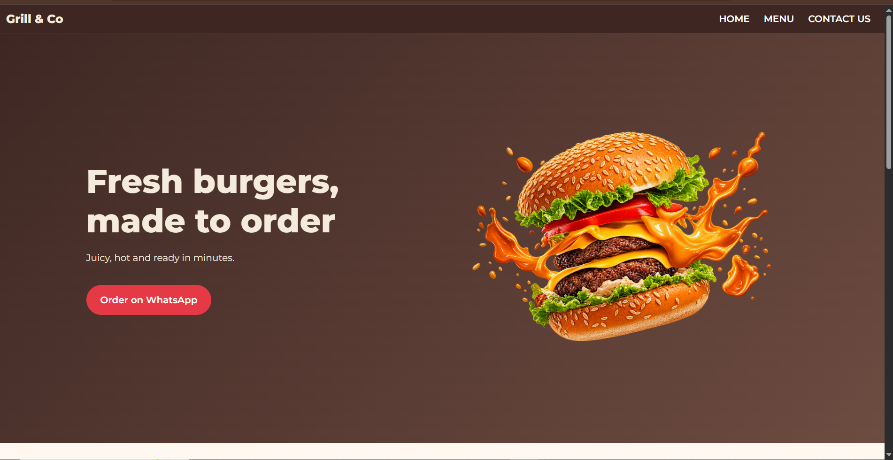
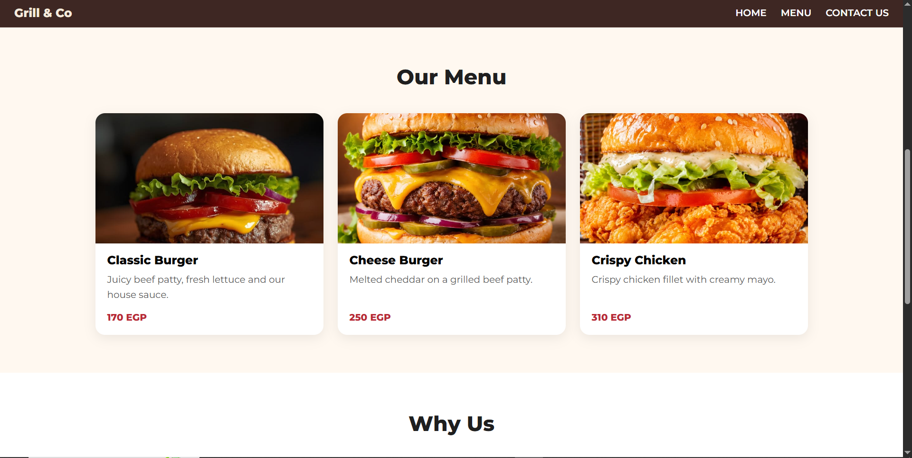
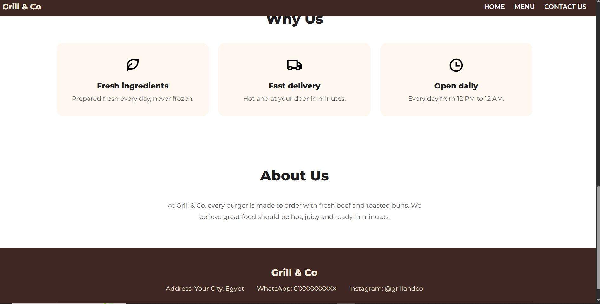

# Grill & Co - Landing Page

Responsive landing page for a fictional burger restaurant.
Built as Task 1 (Level 1) of the Oasis Infobyte Web Development and Designing internship.

## Features
- Sticky navigation bar
- Hero section with a call-to-action button
- Menu and Why Us sections
- Footer with contact placeholders
- Responsive layout (Flexbox and Grid)

## Tech
HTML5, CSS3

## Images
Images were collected online for this practice project and belong to their original owners. They are used for learning purposes only, and no ownership is claimed.

